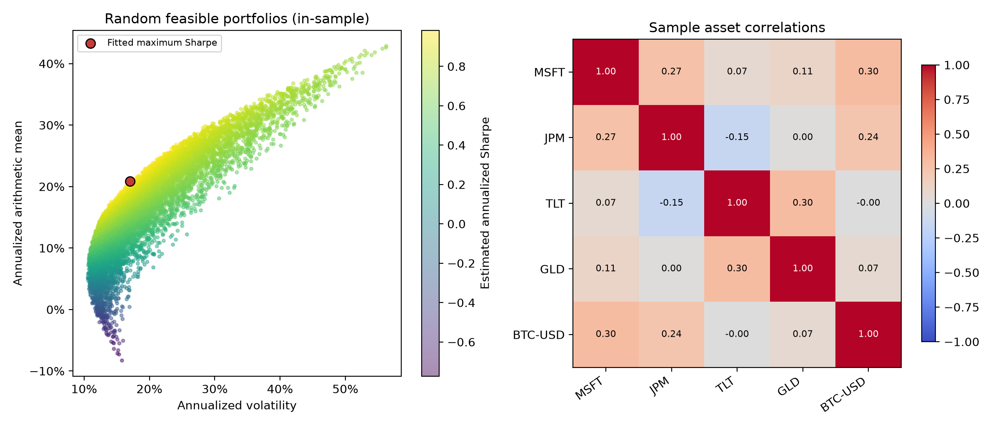
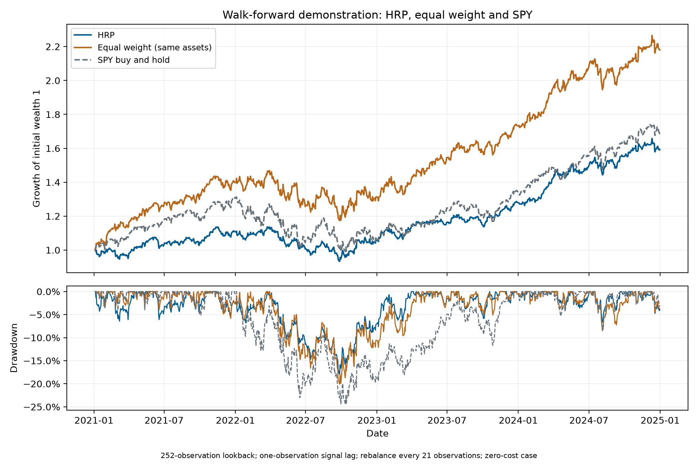

# Portfolio allocation with maximum-Sharpe optimization and HRP

Spark Hu | Original project: November 2025 | Revised draft: 7 October 2026

A rolling hierarchical risk parity (HRP) portfolio and an equal-weight portfolio are evaluated on the same five assets over 2021-2024. HRP had lower volatility and drawdown; equal weighting achieved higher growth and Sharpe. A separate maximum-Sharpe fit illustrates how estimated means and covariances determine an allocation.

## The maximum-Sharpe fit

The first calculation uses MSFT, JPM, TLT, GLD and BTC-USD. Adjusted prices cover 2021-01-04 to 2024-12-31, giving 1004 simple-return observations. Prices are restricted to dates available for all five assets before returns are calculated. This retains the return from Friday to Monday, including Bitcoin's intervening weekend movement.

The optimizer maximizes estimated excess return divided by volatility, subject to nonnegative weights that sum to one. A constant effective annual cash return of 4% is converted to a daily rate. SLSQP solves the constrained problem, and the implementation checks convergence, feasibility and asset-label alignment.

```text
r[p,t] = sum[j] w[j] r[j,t]
Var[r[p]] = w' S w
Sharpe[annual] = sqrt(252) * (w' mu - rf[daily]) / sqrt(w' S w)
```

| Asset | Fitted allocation |
| --- | --- |
| MSFT | 22.72% |
| JPM | 38.53% |
| TLT | 0.00% |
| GLD | 26.93% |
| BTC-USD | 11.83% |



Figure 1. Each point is a sampled allocation evaluated using the fitted means and covariance. The red point is the numerical maximum-Sharpe fit. The cloud shows feasible portfolios; computing the efficient frontier would require further optimization.

The fitted annualized arithmetic mean is 20.83%, with volatility 17.03% and Sharpe 0.993. The empirical daily fifth percentile is -1.65%. These values use the same observations that selected the weights and assume daily rebalancing without costs. They describe the fit rather than unseen-period performance.

## The rolling HRP test

The second calculation invests in MSFT, GOOG, JPM, XLE and GLD. Equal weighting uses these same assets and the same trading schedule, making it a direct allocation comparator. SPY is excluded from estimation and supplies a buy-and-hold market reference.

PyPortfolioOpt's HRP implementation builds a single-linkage tree from correlation distances and allocates using cluster variances. The method avoids a full covariance inverse but still relies on estimated correlations and covariances.

Each allocation uses 252 past return observations. In the first window, the last training return ends on 31 December 2020, execution is modeled at the 4 January 2021 close, and the first evaluated return ends on 5 January. Targets are updated every 21 observations. Holdings drift between updates, so the daily returns reflect the stated trading rule.

The evaluation ends on 2024-12-31 and contains 1004 returns. The table and chart show the zero-cost case.

| Strategy | Final wealth | Compound growth* | Annual vol. | Sharpe | Max. drawdown |
| --- | --- | --- | --- | --- | --- |
| HRP | 1.594 | 12.41% | 12.29% | 0.694 | -17.88% |
| Equal weight (same assets) | 2.181 | 21.61% | 16.01% | 1.057 | -20.06% |
| SPY buy and hold | 1.683 | 13.95% | 16.48% | 0.637 | -24.50% |

* Annualized compound growth is final wealth raised to 252/N, minus one. Sharpe uses daily excess returns under the 4% cash assumption. Drawdown includes initial capital.



Figure 2. Growth and drawdown from the rolling test. HRP's lower measured risk came with lower growth than equal weighting. SPY represents a different asset exposure.

## Costs and interpretation

The cost sensitivity charges 5 basis points per dollar traded, counting both purchases and sales. Initial investment from cash is included. At subsequent updates, the charge depends on the difference between drifted holdings and the new target. Costs are deducted before the next holding block.

| Strategy | Growth: 0 bps | Growth: 5 bps | Sharpe: 0 bps | Sharpe: 5 bps |
| --- | --- | --- | --- | --- |
| HRP | 12.41% | 12.34% | 0.694 | 0.689 |
| Equal weight (same assets) | 21.61% | 21.56% | 1.057 | 1.055 |
| SPY buy and hold | 13.95% | 13.94% | 0.637 | 0.637 |

## What the comparison shows

Equal weighting achieved annualized compound growth of 21.61%, against 12.41% for HRP. Its measured Sharpe was also higher. HRP reduced volatility and drawdown in this sample. This leaves a risk-return trade-off rather than an unqualified advantage for the more elaborate rule.

The maximum-Sharpe fit cannot resolve that comparison. It uses a different asset universe and selects weights on the full sample; HRP estimates its targets on rolling past windows. A matched comparison would have to align assets, estimation windows, constraints and trading assumptions.

## Limits and corrections

These results come from a small selected universe over one historical period. They have not been evaluated on an untouched holdout or subjected to a statistical superiority test. The cash rate is constant, and the 252-observation annualization does not account for serial dependence.

Adjusted daily prices approximate total returns and execution values. They do not synchronize the exact timestamps of every market or fully model slippage, impact and taxes. The empirical VaR is a return quantile, not a bound on future losses. HRP's clustering also provides no explicit sector cap.

The revision corrects mislabelled weights, return aggregation and holding-period accounting, then adds a signal delay, an equal-weight baseline and saved numerical checks. The earlier files and a detailed correction record remain in the archive. A covariance-shrinkage study is planned to separate numerical conditioning from estimation error; it is not included in these historical results.

## Reproducibility and sources

Prices were retrieved at 2026-10-05T08:58:25.056430+00:00. The local CSV's SHA-256 is recorded in results/data-manifest.json. The source commit is ce87a9d13131d03699dd1b0834acd945c54bbb6d. Seed 20261005, run settings, dependency versions and numerical results are saved in results/summary.json; notebooks contain executed outputs.

[López de Prado (2016), Building Diversified Portfolios that Outperform Out-of-Sample.](https://papers.ssrn.com/sol3/papers.cfm?abstract_id=2708678)
[PyPortfolioOpt: HRP implementation.](https://pyportfolioopt.readthedocs.io/en/latest/_modules/pypfopt/hierarchical_portfolio.html)
[SciPy: SLSQP documentation.](https://docs.scipy.org/doc/scipy/reference/optimize.minimize-slsqp.html)
[yfinance: download and adjustment conventions.](https://ranaroussi.github.io/yfinance/reference/api/yfinance.download.html)

Acknowledgment: The October code corrections and this draft were prepared with Codex assistance. The original project dates from November 2025. The author is reviewing the reasoning and wording before sharing the revised work.
